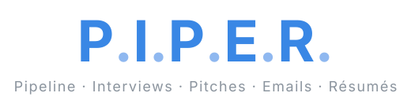
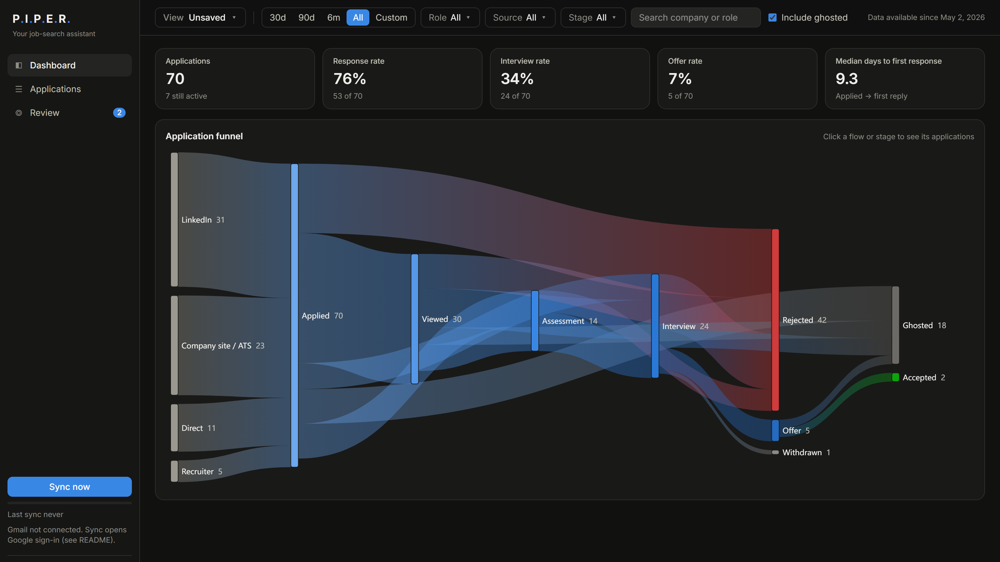

<p align="center">
  
</p>

# P.I.P.E.R.

**P**ipeline · **I**nterviews · **P**itches · **E**mails · **R**ésumés

Piper is a private job-search assistant that runs entirely on your own computer. It reads your
job emails, keeps track of every application, and is growing into an assistant that also writes your
cover letters and messages and helps you apply, all without your data leaving your machine.



<sub>The dashboard with sample data (`piper seed`). Click any flow or stage to see the applications behind it.</sub>

## What Piper does today

- **Finds every application in your inbox.** Piper reads Gmail (read-only) and picks out real updates
  from LinkedIn, applicant-tracking systems (Greenhouse, Lever, Workday, Ashby…), recruiters, and your
  own direct conversations with founders and hiring managers, including calendar invites and bookings.
  Job alerts, newsletters and promotions are filtered out.
- **Understands each email with a local AI model.** A model running in [Ollama](https://ollama.com)
  works out the company, role and stage (applied, viewed, assessment, interview, offer, rejected…)
  and merges everything into one record per application. Emails it isn't sure about go to a
  review queue instead of being guessed.
- **Shows your whole search at a glance.** An interactive funnel (Sankey) shows how applications flow
  from source to outcome, with response, interview and offer rates. Click any part to see the
  applications behind it.
- **Tracks what email can't.** Add applications by hand (company sites that send no confirmation,
  referrals, chats) and log updates like a phone screen or a verbal offer; later emails from the
  company join the same application. Paste a job posting link and **Fill from link** reads the
  company, role and location for you (the page is opened only when you click it).
- **Keeps the full story of every application.** Each one has a timeline of its emails and the live
  email conversation, newest first, with quoted replies stripped so it reads cleanly.
- **Lets you slice it your way.** Filter by date, role type (design, product, VC, other), source and
  stage, and save combinations as views. Applications with no reply for a while are marked ghosted.
- **Stays private.** The AI runs on your machine, the app only listens on `127.0.0.1`, Gmail access
  is read-only, job posting links are opened only when you ask, and all your data lives in `~/.piper/`, never in this repository.

## Where Piper is going

- **Writing Studio:** cover letters, LinkedIn notes, WhatsApp messages and emails written from your
  own résumé, strengths and stories, tailored to each company you engage with. Every piece is kept as a
  conversation thread, and Piper learns your style over time. See
  [docs/PRD-writing-studio.md](docs/PRD-writing-studio.md).
- **Résumé generator:** tailored résumé versions for each role, from the same personal knowledge base.
- **Interview prep:** likely questions and your best matching stories, built from each company's thread.
- **Applying with you:** preparing applications for roles you choose, always with your review before
  anything is sent.
- **More views:** a Kanban board, activity insights and a command palette.

The full product description and roadmap are in [docs/PRD.md](docs/PRD.md).

## Quick start

Prerequisites: [uv](https://docs.astral.sh/uv/), Node 20+, and [Ollama](https://ollama.com/download).

```bash
uv sync
cd web && npm install && npm run build && cd ..

ollama pull qwen2.5:7b-instruct   # ~4.7 GB, fits fully in 8 GB VRAM
uv run piper doctor          # checks Ollama, the model and GPU use

uv run piper seed            # optional: sample data to explore the UI
uv run piper ui              # native window (add --browser for a browser tab)
```

## Start the app

Double-click **`start.bat`** (or run `.\start.ps1` in PowerShell; add `--browser` for a browser tab).
It finds `uv`, starts Ollama if it isn't running, installs dependencies on first run, rebuilds the
UI only when its source changed, and opens the app. Close the window to quit.

## Connect Gmail

1. Open the [Google Cloud Console](https://console.cloud.google.com/) and create a project
   (e.g. "Piper").
2. **APIs & Services → Library**: search for **Gmail API** and click **Enable**.
3. **APIs & Services → OAuth consent screen** (Google Auth Platform → Branding/Audience):
   - User type: **External**. Fill in the app name and your email.
   - **Audience → Test users**: add your own Gmail address. While the app is in "Testing" only
     test users can sign in, and that is all you need.
   - **Data access → Add scopes**: add `https://www.googleapis.com/auth/gmail.readonly`.
4. **APIs & Services → Credentials → Create credentials → OAuth client ID**:
   - Application type: **Desktop app**.
   - Download the JSON and save it as `~/.piper/credentials.json`
     (on Windows: `C:\Users\<you>\.piper\credentials.json`).
5. Run `uv run piper sync --dry-run`. A browser window opens; sign in and allow read-only
   access. Google warns that the app is unverified; click **Continue** (it is your own app).
   The token is cached in `~/.piper/token.json`.
6. The dry run lists the matching subjects and whether the prefilter keeps or drops each. When it
   looks right, run `uv run piper sync` (or click **Sync now** in the app).

Note: in "Testing" mode Google expires refresh tokens after 7 days, so you may need to sign in
again weekly. Publishing the app (no verification needed for personal use) removes that limit.

## Commands

| Command | What it does |
|---|---|
| `piper ui [--browser] [--port N]` | Start the app. Syncs every `SYNC_INTERVAL_HOURS` while open, plus once shortly after start (only once Gmail is connected). |
| `piper sync [--dry-run] [--full]` | Fetch and extract. Later syncs only fetch mail since the last sync; `--full` re-runs the whole backfill. Already-processed emails are never sent to the LLM again. |
| `piper doctor` | Check Ollama, the model and GPU use. |
| `piper seed [--force]` | Add sample applications and two saved views. |
| `piper stats [--range 30d\|90d\|180d\|all]` | Print funnel stats. |
| `piper reset [--yes]` | Delete the database and Gmail token. |

## Configuration

Copy `.env.example` to `~/.piper/.env` (or `./.env`). Environment variables win over both.

| Variable | Default | |
|---|---|---|
| `OLLAMA_MODEL` | `qwen2.5:7b-instruct` | Any instruct model that fits your VRAM. |
| `OLLAMA_HOST` | `http://localhost:11434` | |
| `GHOST_DAYS` | `30` | No event for this long (and not finished) → shown as ghosted. |
| `SYNC_INTERVAL_HOURS` | `6` | Background sync interval while the app is open. |
| `BACKFILL_DAYS` | `180` | How far back the first sync reads. The date filter can't go further back than this. |
| `INCLUDE_SENT_THREADS` | `true` | Include whole threads you sent mail in (direct outreach and conversations). |
| `FOLLOW_COMPANY_DOMAINS` | `true` | Include all mail from companies you're in a hiring process with (calendar invites, bookings). |
| `ALWAYS_INCLUDE` / `ALWAYS_IGNORE` | | Comma-separated domains or addresses to always keep / always drop. |
| `GMAIL_EXTRA_QUERY` | | Extra Gmail search added to the main one, e.g. `from:acme.com`. |

**Your own rules:** put subject patterns that are never job emails in `~/.piper/never_job_subjects.txt`,
one regular expression per line (case-insensitive, `#` for comments). They're applied before the model
sees anything, and changing them re-checks previously skipped mail on the next sync.

All personal data — the Gmail token, the OAuth client file, the database and these settings — lives in
`~/.piper/` (or `PIPER_HOME`), never in the repository.

## Documentation

The full product description, requirements and roadmap are in [docs/PRD.md](docs/PRD.md).

## Development

```bash
uv run pytest                     # backend tests
uv run piper ui --browser --port 8000
cd web && npm run dev             # Vite dev server with /api proxied to :8000
```

Low-confidence or unparseable extractions go to the **Review** page, where you can fix or dismiss
them. Changing an application's stage by hand sets a manual override that later emails won't
change; "Clear override" in the table goes back to the automatic stage.

## License

[MIT](LICENSE) © Kn1ghtF0x
